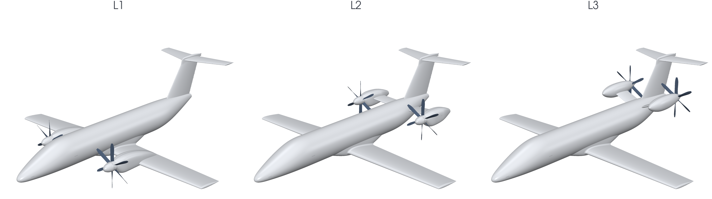
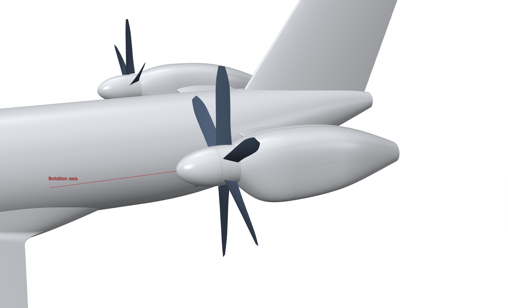
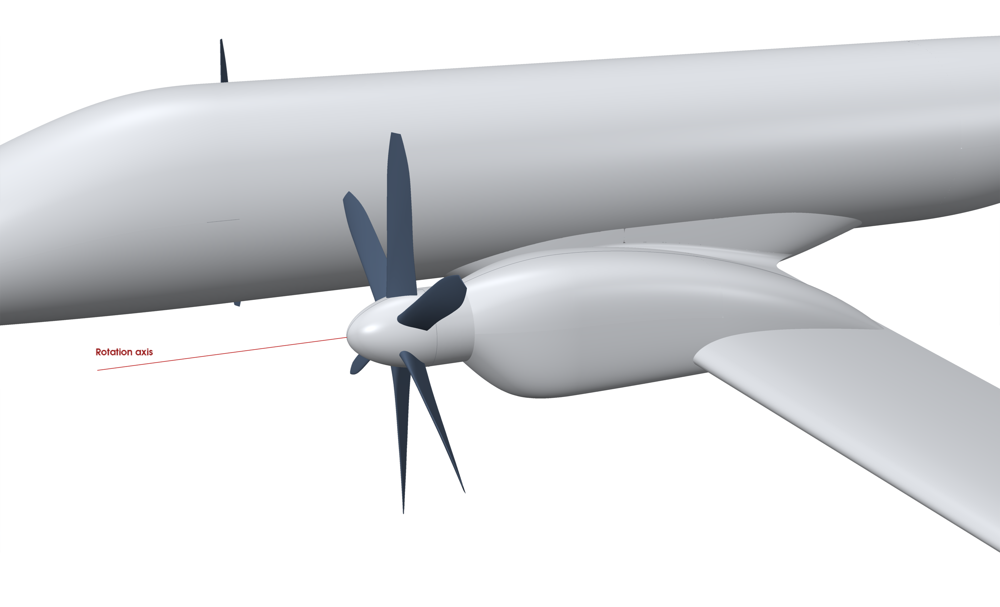
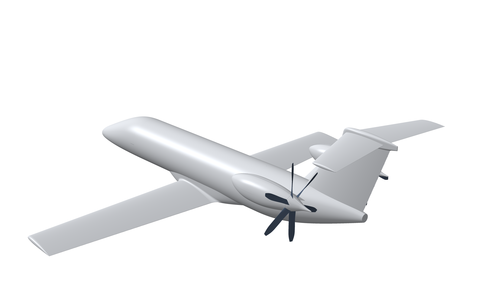
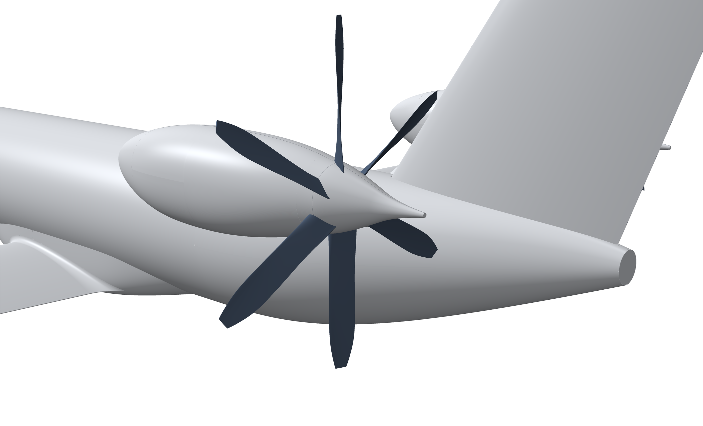

--8<-- "geometry/GEOMETRY_LOG.md"

## Renders

The renders show the XPROP propeller blades for orientation. The blades are not part of the geometry files.

SMI-L3 with the TU Delft XPROP propeller, shown for orientation. The propeller is not included in the repository.
