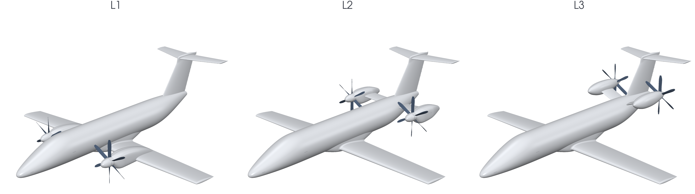

# SMI Framework

--8<-- "README.md:intro"



<div class="grid cards" markdown>

-   :material-airplane: **Geometry**

    ---

    The SMI airframe and its three installations as IGES surfaces, with axes, units and reference dimensions.

    [:octicons-arrow-right-24: Geometry](geometry/index.md)

-   :material-function-variant: **Method**

    ---

    The Python package `smi_framework` and the method deck: from solver polars to decomposition, stability and sizing.

    [:octicons-arrow-right-24: Method](method/index.md)

-   :material-file-document-multiple: **Publications**

    ---

    The papers that used SMI, with their status, and the inputs, polars and figure data of each one.

    [:octicons-arrow-right-24: Publications](publications/index.md)

</div>

## How to cite

--8<-- "README.md:cite"

The citation file of the repository, `CITATION.cff`:

```yaml
--8<-- "CITATION.cff"
```
